<picture>
  <source media="(prefers-color-scheme: dark)" srcset="https://raw.githubusercontent.com/SergioAscurraPerez/SergioAscurraPerez/main/assets/header-dark.svg">
  
</picture>

<picture>
  <source media="(prefers-color-scheme: dark)" srcset="https://raw.githubusercontent.com/SergioAscurraPerez/SergioAscurraPerez/main/assets/chart-dark.svg">
  
</picture>

Las velas no son decoración: cada una es una semana real de mi actividad en GitHub. El índice SRGO cuenta las contribuciones de los últimos 7 días; una vela verde cierra la semana por encima de donde la abrió. Un <a href="scripts/render.py">script sin dependencias</a> consulta la API de GitHub y redibuja los tres paneles cada madrugada mediante GitHub Actions.

 

## Posiciones abiertas

| Proyecto | Tesis | Resultado | Stack |
|---|---|---|---|
| **[Sentinela AML](https://github.com/SergioAscurraPerez/sentinela-aml)** | El triaje de alertas de lavado de activos puede ser multiagente sin perder control humano: 9 agentes descubiertos y verificados mediante NANDA, riesgo calculado de forma determinista fuera del LLM, datos pseudonimizados antes de salir y aprobación humana en cada decisión. | **1.er puesto**, Hack AI Agents Impact 2026 (NTT DATA × Sundai LATAM × Project NANDA, MIT Media Lab) | Python, Streamlit, pandas, networkx, scikit-learn, Ollama / OpenRouter |
| **[Trading algorítmico EURUSD](https://github.com/SergioAscurraPerez/trading-eurusd)** | Señales semanales con LightGBM a partir del COT Report, validadas con walk-forward y Monte Carlo. | Una auditoría de datos descartó una ventaja que era falsa; el sistema corre en MT5 sobre una VM de Azure | Python, LightGBM, MetaTrader 5, Azure |
| **Auditor de sílabos con LLM** | Un LLM open-source autoalojado puede auditar sílabos universitarios y emitir reportes de cumplimiento sin enviar datos fuera de la institución. | En uso interno en la Facultad de Medicina Humana de la USMP | Python, pdfplumber, ReportLab |

## Historial

- **Asistente informático (práctica)**, Facultad de Medicina Humana, USMP. Febrero a agosto de 2026. Digitalización de procesos y auditor de sílabos con LLM.
- **Desarrollador web**, Ceneris E.I.R.L. Sistemas de talento humano, equipos de minería y proyectos con Django, .NET y PostgreSQL. Migré más de 1,000 registros desde hojas de cálculo a PostgreSQL y construí dashboards de HR Analytics con Chart.js.

<picture>
  <source media="(prefers-color-scheme: dark)" srcset="https://raw.githubusercontent.com/SergioAscurraPerez/SergioAscurraPerez/main/assets/langs-dark.svg">
  
</picture>

## Formación

<picture>
  <source media="(prefers-color-scheme: dark)" srcset="https://raw.githubusercontent.com/SergioAscurraPerez/SergioAscurraPerez/main/assets/formacion-dark.svg">
  
</picture>

Ver la formación en texto

**Universal AI Program, MIT Open Learning.** Desde mayo de 2026, en curso.

| Estado | Módulo |
|---|---|
| ✔ | Introduction to Universal AI · Python Coding (partes 1 y 2) · Foundations of Data Analytics and Machine Learning |
| ✔ | Supervised and Unsupervised Learning · Foundations of Neural Networks · Hands-On Deep Learning |
| ✔ | Deep Learning and Computer Vision · Data-Driven Prescriptive AI |
| ▶ | Model-Driven Prescriptive AI, Part 1 |

**Ingeniería de Computación y Sistemas, USMP.** 8.º ciclo de 10.

## Contacto

<picture>
  <source media="(prefers-color-scheme: dark)" srcset="https://raw.githubusercontent.com/SergioAscurraPerez/SergioAscurraPerez/main/assets/ticket-dark.svg">
  
</picture>

<a href="https://www.linkedin.com/in/sergio-ascurra-perez-14002440b/"><picture>
  <source media="(prefers-color-scheme: dark)" srcset="https://raw.githubusercontent.com/SergioAscurraPerez/SergioAscurraPerez/main/assets/key-linkedin-dark.svg">
  
</picture></a> <a href="mailto:sergioascurra.27102005@gmail.com"><picture>
  <source media="(prefers-color-scheme: dark)" srcset="https://raw.githubusercontent.com/SergioAscurraPerez/SergioAscurraPerez/main/assets/key-email-dark.svg">
  
</picture></a>

[LinkedIn](https://www.linkedin.com/in/sergio-ascurra-perez-14002440b/) · [sergioascurra.27102005@gmail.com](mailto:sergioascurra.27102005@gmail.com)

 

Paneles regenerados a diario por <a href=".github/workflows/terminal.yml">GitHub Actions</a>. Los SVG se animan sin JavaScript y respetan <code>prefers-reduced-motion</code>; el modo claro u oscuro sigue el de tu GitHub.
